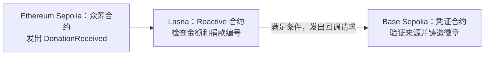

# 用例拆解卡：跨链众筹支持者凭证

> **状态：设计想法，尚未实现或部署。** 这个案例用于理解 Reactive 的工作流程；下面的合约、事件和规则都是设想，并不代表已有项目具备这些功能。

## 场景

一个众筹项目在 Ethereum Sepolia 测试网上接受捐款。为了让支持者在 Base Sepolia 上获得一枚纪念凭证，项目希望在符合条件的捐款发生后，自动触发凭证合约铸造徽章。

选择两条链是为了练习跨链自动化；如果没有在另一条链发凭证的实际需求，把凭证留在同一条链可能更简单。

## 1. 监听什么事件？

- **来源链：** Ethereum Sepolia。
- **来源合约：** 假设由项目方部署的众筹合约。
- **事件：** 合约在收到捐款后发出 `DonationReceived`（收到捐款）事件。
- **事件信息：** 捐款人地址、捐款金额和唯一捐款编号。

Reactive 合约订阅这个特定合约的 `DonationReceived` 事件。这里的事件名称和字段是设计，不是已存在的链上记录。

## 2. 满足什么条件时触发？

收到事件后，Reactive 合约检查：

1. 单笔捐款是否达到 **0.01 Sepolia ETH**。
2. 这笔捐款是否已经处理过，避免同一笔捐款重复发放凭证。

两项条件都满足时，才请求回调。门槛按单笔计算，而不是累积多笔捐款。

## 3. 在哪条链执行什么动作？

Reactive 合约请求向 **Base Sepolia** 上假设部署的支持者凭证合约发送回调。凭证合约验证请求来源，并确认捐款编号未被处理后，为捐款人铸造一枚支持者徽章。

需要额外设计防重复机制，并确认只有授权的 Reactive 合约能触发铸造。回调传递的是执行请求和相关信息；捐款资金并不会因此自动从 Sepolia 转移到 Base Sepolia。

## 4. 为什么使用 Reactive？

**不用 Reactive：** 可以自己运行一个链下机器人，持续检查众筹事件，在达到门槛时向 Base Sepolia 发交易。项目方也可以手动核对捐款并发放徽章。

**使用 Reactive 的潜在好处：** 用事件驱动的合约自动完成判断和回调请求，不必自己维护持续监听并提交交易的机器人。

**代价和限制：**

- 需要维护 Reactive 合约和目标链凭证合约，两个网络的执行都需要资金。
- 必须检查回调身份并防止重复处理；不能只相信任意人提交的捐款信息。
- 跨链回调可能延迟或失败，需要查看结果，并设计补处理方式。
- 是否跨链要看产品需求；若同链发放或用户手动领取已足够，加入跨链自动化可能不划算。

## 流程图

以上是测试网方案：来源链使用 Sepolia，Reactive 侧使用 Lasna，目标链使用 Base Sepolia。
